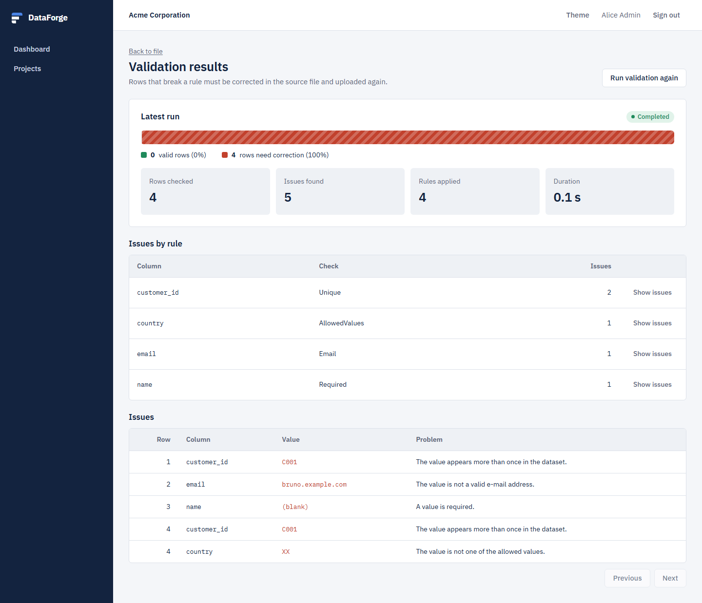
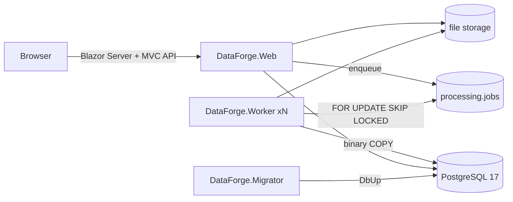

# DataForge

**Enterprise data onboarding and validation platform.** Customers upload large CSV exports. DataForge streams them into PostgreSQL, validates every row against project rules in background workers, and shows exactly which values must be fixed before go-live.

DataForge is built with .NET 10, Blazor, the ASP.NET Core MVC API, Dapper, PostgreSQL and a durable PostgreSQL job queue. It is tested at four levels (unit, architecture, integration with Testcontainers, end-to-end with Playwright) and load-tested with k6.



## What it does

1. **Projects and rules.** A customer creates an onboarding project and defines rules per column: required, maximum length, regex, e-mail, numeric range, date format, allowed values, unique in file.
2. **Streaming upload.** The file goes straight to storage. It is hashed (SHA-256) and size-checked on the fly, never buffered. Uploading the same content again is idempotent.
3. **Background import.** A worker parses the file with Sep, which detects `,` `;` tab and `|`. Batches flow through a bounded channel and are written with binary COPY, with a checkpoint after each batch.
4. **Automatic validation.** An integration event starts validation as soon as the import finishes. Rows are validated in parallel. Uniqueness is one set-based SQL aggregate per rule.
5. **Results.** A quality strip shows the share of valid rows, followed by issues per rule and a keyset-paginated list of every offending value. The customer can run the validation again after uploading a corrected file.
6. **Implementation console (basic).** The internal team sees processing activity across every tenant.

## Architecture



- **Modular monolith** with four modules: Identity, Onboarding, Validation, Processing.
  - Each module is split into `Domain`, `Application`, `Infrastructure`, `Contracts` and `Presentation` projects.
  - Modules talk to each other only through `Contracts`. [ADR-0001](docs/adr/0001-modular-monolith.md)
- **Durable job engine on PostgreSQL:**
  - jobs are claimed with `SKIP LOCKED`, owned through a lease and heartbeat, with fencing tokens;
  - failures retry with exponential backoff;
  - an interrupted job resumes from its checkpoint, and a stopping worker releases its job cleanly.

  [ADR-0003](docs/adr/0003-postgres-job-queue.md)
- **Constant-memory streaming:** bounded `Channel<T>` with backpressure, binary COPY, and idempotent resume that is proven by a test. [ADR-0005](docs/adr/0005-streaming-pipeline-copy-and-channels.md)
- **Multi-tenancy:**
  - every query filters by tenant, and modules reference each other by public UUID;
  - the API never exposes internal ids;
  - cross-tenant access returns 404, verified by integration and end-to-end tests.

All decisions are recorded in [`docs/adr`](docs/adr).

## Quick start

Requirements: Docker.

```bash
docker compose -f deploy/compose/docker-compose.yml up --build -d
# open http://localhost:8080
```

All demo accounts use the password `DataForge!Demo2026` (local only; override it with `DEMO_PASSWORD`, see `.env.example`).

| Account | Role |
|---|---|
| `admin@acme.demo` | Customer administrator (Acme Corporation) |
| `analyst@acme.demo` | Customer member (Acme Corporation) |
| `admin@globex.demo` | Customer administrator (Globex Industries), to check tenant isolation |
| `engineer@dataforge.demo` | Implementation engineer: operations console across tenants |

## Quality evidence

| Level | What it proves | Location | Result |
|---|---|---|---|
| Unit (101) | Rules, job runner outcomes, pipeline backpressure, upload idempotency, authentication timing equalization | `tests/BuildingBlocks`, `tests/Modules` | Passing |
| Architecture (29) | Module boundaries, layer direction, naming suffixes, one artifact kind per folder, sealed classes, Dapper only in Infrastructure | `tests/DataForge.ArchitectureTests` | Passing |
| Integration (17) | Migrations, full pipeline, 25k-row batching, resume after a crash, `SKIP LOCKED` under 8 concurrent workers, lease fencing, CSRF, tenant isolation | `tests/DataForge.IntegrationTests` (PostgreSQL 17 via Testcontainers) | Passing |
| End-to-end (7) | Sign-in and access control, onboarding to validation results in the browser, tenant isolation | `tests/DataForge.E2ETests` (Playwright against Docker Compose) | Passing; screenshots in [`docs/evidence/e2e`](docs/evidence/e2e) |
| Load | Baseline at 10 VUs: 4,860 req/s, p95 3.1 ms, 0% errors (single machine, see caveats) | [`docs/performance`](docs/performance/baseline-2026-10-29.md) | Measured |

```bash
pwsh scripts/verify.ps1      # build + unit + architecture + integration (needs Docker)
pwsh scripts/e2e.ps1         # compose up + Playwright + evidence
```

**Not yet claimed:** throughput on datasets with tens or hundreds of millions of rows. The pipeline is designed for it (constant memory, COPY, keyset pagination, checkpoints), but no number is published until it is measured. See [STATUS.md](STATUS.md).

## Status and roadmap

The MVP flow (sign-in, project, upload, import, validation, results) is implemented and covered by the suites above. Planned next, in this order (details in [STATUS.md](STATUS.md)):

1. Load profiles at 50–500 virtual users and import/validation throughput for 1M+ rows (dataset generator and BenchmarkDotNet).
2. Correction, cancel/resume and export flows in the UI, plus responsive end-to-end tests.
3. An observability profile with the OpenTelemetry Collector, Prometheus and Grafana.
4. Production key management for ASP.NET Core Data Protection.

## Repository layout

```
src/BuildingBlocks/   Result, ApiResponse, pipeline, storage, tenancy, DbUp migrator, middlewares, UI kit
src/Modules/<Module>/ Domain · Application (use cases) · Infrastructure (SQL, COPY) · Contracts · Presentation (pages, controllers)
src/Hosts/            Web, Worker, Migrator
tests/                unit · architecture · integration · e2e · k6
docs/                 adr · engineering · performance · evidence
deploy/               docker · compose
```

## Engineering process

DataForge is developed with **spec-driven development and Claude Code**:
1. Specifications and acceptance criteria come first.
2. AI assists with implementation, refactoring and tests.
3. Every change is reviewed and gated by the automated suites above.

The project conventions for humans and agents are in [CLAUDE.md](CLAUDE.md) and [AGENTS.md](AGENTS.md). The coding standard is in [docs/engineering/coding-standards.md](docs/engineering/coding-standards.md).

## License

[MIT](LICENSE)
